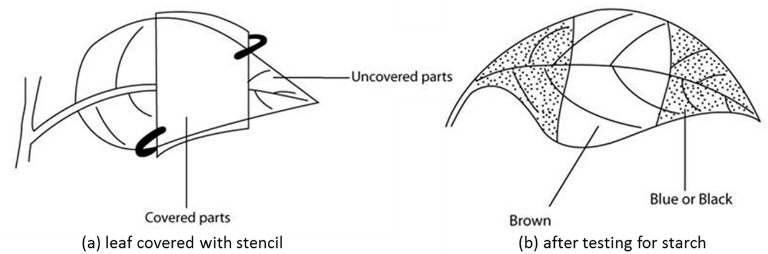

## Investigation of Light Intensity

**NOTE: This type of question is frequently asked in Paper 2.**

* De-starch the plant by keeping it in the dark for 48 hours
* Place a stencil over part of a leaf
* Place the leaf in sunlight for 4-6 hours
* Remove the stencil and test for starch
* **+ve result = parts which received light turn blue-black**
* **-ve result = parts that didn’t receive light remain brown**

