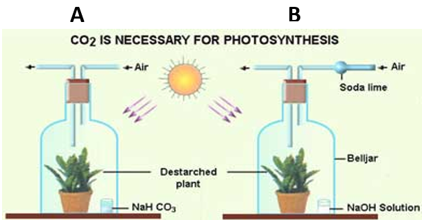
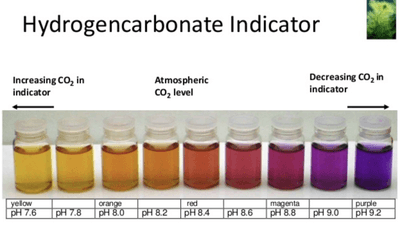

## Investigation of Carbon Dioxide Concentration

* Take two de-starched potted plants.
* Cover both the plants with bell jars and label them A and B.
* Inside A, keep $NaHCO_3$ (Sodium Bicarbonate). It produces $CO_2$.
* Inside B, keep $NaOH$ (Sodium Hydroxide). It absorbs $CO_2$.
* Keep both set-ups and do the starch test in the sunlight for at least 6 hours

* The leaves of Plant A will turn black after the starch test
* The leaves of Plant B will remain brown after the starch test

**Hydrogencarbonate indicator**: measures the carbon dioxide concentration     **Key:** PMROY, purple being the lowest carbon dioxide concentration, and yellow the highest.