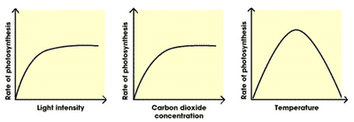
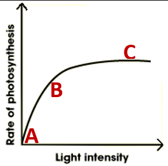

## Limiting Factors

**Limiting Factors**: Conditions where something present in the environment (Temperature, Carbon Dioxide Concentration and Light Intensity) is in such short supply that it restricts life processes.

### Light intensity

* As the amount of light increases, the rate of photosynthesis increases (A-B)

* The limiting factor is light

* Increasing the amount of light after a certain point does not affect the rate (C)

* The limiting factor is now carbon dioxide or temperature.