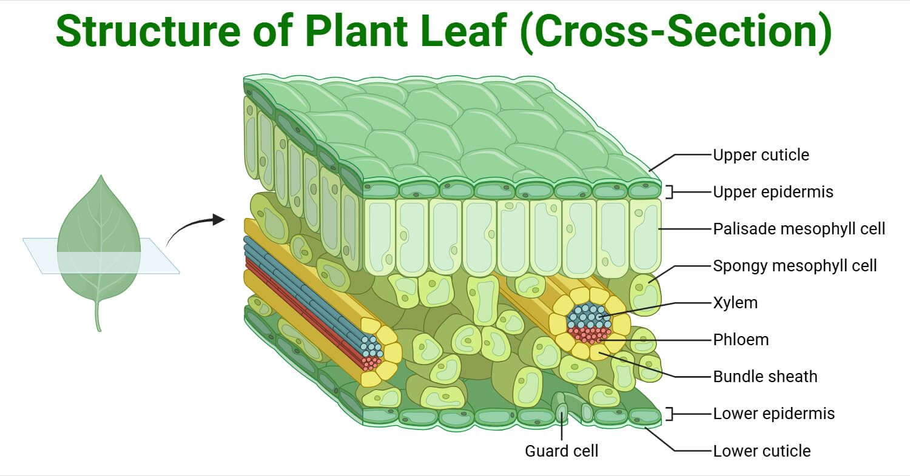
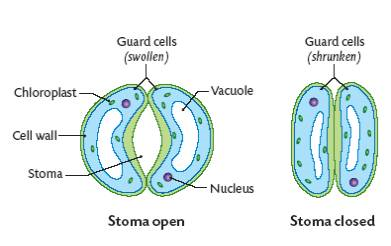

## Leaf Structure

Most dicotyledonous plant leaves have a **large surface area** and are **thin**.

#|
||

**Structure**

|

**Function**

||
||

Waxy Cuticle

|

A waterproof waxy layer that prevents water loss from the top of the leaf

||
||

Upper & Lower Epidermis

|

Thin and transparent to allow light to enter the palisade mesophyll cells

||
||

Palisade Mesophyll Cells

|

Found at the top of the leaf surface and contains the **MOST chloroplasts** that absorb sunlight for photosynthesis.

||
||

Spongy Mesophyll Cells

|

Irregularly shaped cells create air spaces to allow the gaseous exchange to take place; do not contain many chloroplasts

||
||

Vascular Bundle

|

Made up of xylem and phloem

||
||

Xylem

|

A tissue vessel that transports water and mineral ions

||
||

Phloem

|

A tissue vessel that transports sucrose and amino acids

||
||

Stomata/Stoma

|

Tiny gaps that open and close to allow the gaseous exchange to occur

||
||

Guard Cells

|

Control the opening and closing of stomata

||
||

Air Spaces

|

Air spaces in the spongy mesophyll layer facilitate gas exchange between the atmosphere and the cells

||
|#

### Opening and closing of Stomata:

* Stomata open when guard cells absorb water by osmosis, become turgid, and curve outward, creating a gap.

* They close when guard cells lose water, become flaccid, and collapse, sealing the pore to reduce water loss.

> **Syllabus 6.2.3**: You must be able to explain how the structures above adapt leaves for photosynthesis