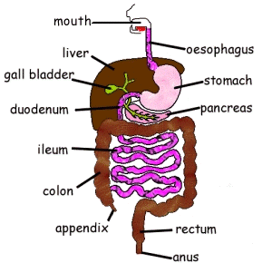

## Digestive System

### **Process of Digestion**

* **Ingestion:** taking substances (e.g. food, drink) into the body through the mouth.
* **Physical/Mechanical Digestion:** breakdown of food into smaller pieces without chemical change.
  * It increases the **surface area of food** for the action of enzymes in chemical digestion.
* **Chemical Digestion**: breakdown of large, insoluble food molecules into small, soluble molecules.
* **Absorption**: the movement of nutrients from the intestines into the blood
* **Assimilation**: uptake and use of nutrients by cells
* **Egestion:** the removal of undigested food from the body as faeces

### **Main Organs in the Digestive System**

* **Mouth:** contains teeth used for mechanical Digestion, an area where food is mixed with salivary amylase & where ingestion takes place
* **Salivary glands:** produce saliva, which contains amylase and helps food slide down the oesophagus
* **Oesophagus:** tube-shaped organ that uses peristalsis (circular muscle contract and relax) to transport food from mouth to stomach
* **Stomach:** has **pepsin** (a protease that works best in **acidic conditions**) to break down proteins into amino acids and kills bacteria with hydrochloric acid. They also have elastic walls.
  * Mechanical digestion in the stomach **occurs via peristaltic contractions of the smooth muscle.**
* **Small intestine:** tube-shaped organ composed of three parts:
  * **Duodenum:** fats are emulsified by bile and digested by pancreatic lipase to form fatty acids and glycerol. Pancreatic amylase and trypsin (a protease) break down starch.
  * **Jejunum** (not in syllabus)
  * **Ileum:** Maltase breaks down maltose to glucose. This is where absorption also takes place.
* **Pancreas:** produces amylase, trypsin (a protease that works best in **alkaline conditions**), and lipase.
* **Liver:** produces bile (emulsifies fats, neutralises acidic fat molecules), deamination, and makes urea to be sent to the kidney. Also, it is the site of the breakdown of alcohol and other toxins.
* **Gall bladder:** stores bile from the liver
* **Large intestine:** tube-shaped organ composed of two parts:
  * **Colon:** organ for absorption of minerals and vitamins and reabsorbing water from waste to maintain the body’s water levels
  * **Rectum:** where faeces are temporarily stored
* **Anus:** a ring of muscle that controls when faeces is released.

**Alimentary canal:** 9 meter long tube which extends from the mouth to the anus. The alimentary canal consists of the mouth, oesophagus, stomach, small intestine, large intestine, rectum and then finally the anus. 

* As the food enters from the mouth, it passes through the alimentary canal and finally gets excreted as faeces from the anus

* takes almost 30-40 hours for food to get converted into nutrients and waste products

* food moves down the alimentary canal through **peristalsis,** which is the involuntary contraction of muscles. Another example of peristalsis is breathing.