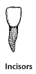
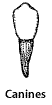
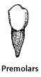
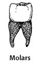
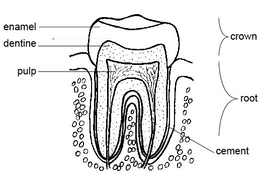

## Teeth

Our teeth play a key role in **mechanical digestion** to help increase the surface area of food.

#|
||

Incisors

|

Canines

|

Premolars

|

Molars

||
||

|

|

|

||
||

Rectangular shape, sharp for cutting and biting

|

Sharp-pointed for piercing and tearing

|

Blunt for chewing and grinding, one or two roots, cusps/bumps at the end

|

Blunt chewing and grinding. Two or three roots, ridges at the end

||
|#

### **Structure of Tooth**

Our teeth are embedded into our  jawbone, and the gums are soft tissue surrounding the bone which prevent bacteria from infecting the roots.

* **Enamel:** the strongest tissue in the body made from calcium salts
* **Cement:** helps to anchor tooth
* **Pulp:** contains tooth-producing cells, blood vessels, and nerve endings that detect pain.
* **Dentine:** calcium salts deposited on a framework of collagen fibers
* **Nerves:** Detect sensation
* **Blood vessels:** Provide nutrition