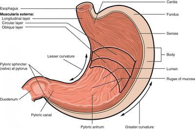

## The Stomach

The stomach lining contains many smooth muscles that contract to squeeze physically and mix the food with the strong digestive juices present, a process also known as "stomach-churning."
- The food will be digested within the stomach for several hours
- First stop for **protein digestion**

 
