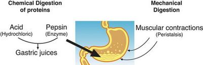

## Chemical Digestion

- **Chemical Digestion**: the breakdown of large insoluble molecules into small soluble molecules
- The role of chemical digestion is to produce small soluble molecules that can be absorbed

