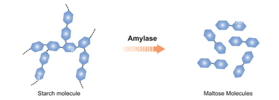
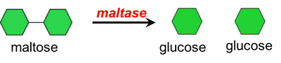
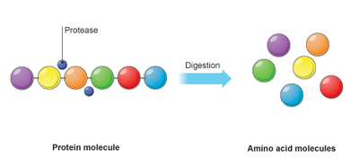
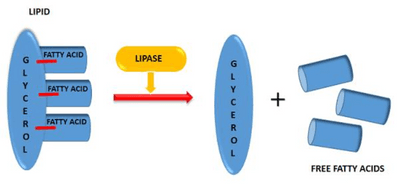

## Enzymes in Digestion

* **Amylase:** breaks down starch into maltose; it is produced in the pancreas (secreted into the duodenum) and salivary glands.

* **Maltase**: breaks down maltose into glucose in the membrane of the epithelium lining in small intestines.

* **Protease:** breaks down proteins into peptides and amino acids. Pepsin comes from the stomach (acidic), and trypsin comes from the pancreas (alkali).

* **Lipase:** breaks down lipids into fatty acids and glycerol,
  produced by the pancreas.

