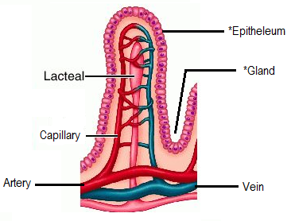

## Absorption and Villus

**Absorption:** the movement of nutrients from the intestines into the blood

* The small intestine is the region for **absorption of digested food** through diffusion, osmosis, and active transport.
* The small intestine is folded into many villi, increasing the **surface area for absorption**. One villus will have tiny folds on the cells on its outside called **microvilli**.
* The epithelium is **one cell thick**, allowing **efficient diffusion of nutrients**.
* A **large surface area** means more absorption of nutrients can happen.
* **Lacteals:** absorbs fatty acid and glycerol
* **Capillaries:** provide a good blood supply and a steep concentration gradient.
* **Goblet Cells:** Produces mucus 
* Most water is absorbed from the small intestine, and some from the colon (large intestine).