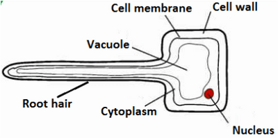

## Water Uptake

**Root Hair Cells**

* **Function:** to absorb water and minerals from the soil
* They have an elongated shape for a larger surface area, which increases the water absorption rate by osmosis and ions by active transport.

The **large surface area** of root hairs is crucial as it increases the uptake of water and mineral ions.

* Water enters root hair cells from moist soil via osmosis because water potential is higher in soil than in the cytoplasm.
* Then, it enters the root cortex cells, xylem, and mesophyll cells.

### **Investigate the Pathway of Water through the Above-Ground Parts of a Plant**

* Water uptake can be investigated by placing a plant (like celery) into a beaker of water with a stain (dye, food colouring) added.
* A few hours later, the celery leaves turn the same colour as the dyed water.
* When the cross-section of the celery is cut, only certain areas are stained by the colour of the water, showing that it is being carried in specific vessels through the stem - a.k.a **xylem vessels.**

