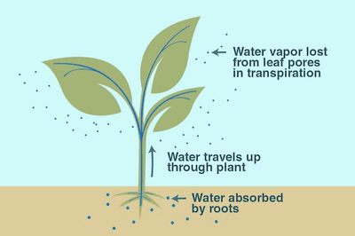

## Transpiration

**Transpiration:** loss of water vapour from leaves, which evaporates from the surface of the mesophyll cells into the air spaces and diffuses out of the leaves through the stomata.        

* Water leaves mesophyll cells into air spaces created by an irregular shape of spongy mesophyll cells, then diffuses out of the stomata.
* Water vapour loss is due to the **large internal surface area** provided by the **interconnecting air spaces between mesophyll cells** and the size and number of stomata.
* Water moves **upwards in the xylem** in terms of a transpiration pull that draws up a column of water molecules held together by cohesive and adhesive forces of attraction between water molecules.

### **Wilting**

**Wilting** occurs if water loss exceeds water uptake. Cells become flaccid, and tissues become limp.

- This is when all the cells of the plant are not full of water, so the strength of the
  cell walls cannot support the plant, and it starts to collapse

### **Factors affecting the Rate of Transpiration**

* **Temperature:** The kinetic energy of the water molecules increases, so they evaporate and diffuse faster from the mesophyll cells, increasing the transpiration rate
* **Humidity:** Low humidity increases the concentration gradient between the leaf and the atmosphere, hence increasing the transpiration rate, while high humidity decreases the gradient, reducing the transpiration rate.
* **Wind Speed:** Removing water molecules to maintain a steep concentration gradient