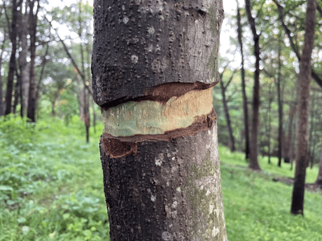

## Translocation

**Translocation:** Movement of sucrose and amino acids in the phloem from regions of production (sources) to regions of storage or regions of utilisation in respiration or growth (sinks).

* Translocation in different seasons:
  * **Spring**: sucrose transported from stores in roots to leaves
  * **Summer** & early autumn: sucrose goes from photosynthesizing
    leaves to root stores,
  * Below is a picture of a **girdle** in a tree trunk.

 