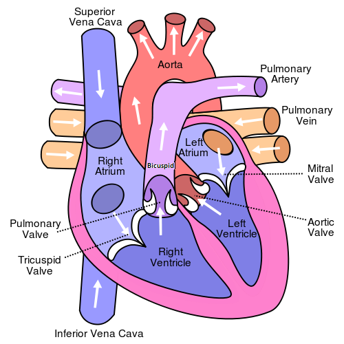
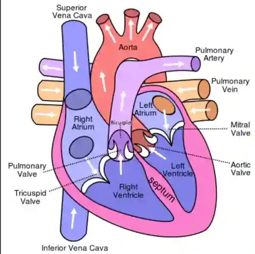

## Heart

The mammalian heart contains a **systemic and pulmonary circuit**.

* **Right Atrium:** collect deoxygenated blood & pump it to the right ventricle
* **Right Ventricle:** pumps deoxygenated blood to lungs
* **Pulmonary Artery:** carries deoxygenated blood from the right ventricle to the lungs
* **Septum:** separates the left and right sides of the heart and keeps deoxygenated and oxygenated blood separate.
* **Pulmonary Vein:** carries oxygenated blood from the lungs to the left atrium
* **Left Atrium:** collect oxygenated blood and pump it to the left ventricle
* **Left Ventricle:** pumps oxygenated blood to the body via the aorta
* **Aorta:** carries oxygenated blood from the left ventricle to the rest of the body
* **Atrioventricular and Semi-lunar Valves:** prevent backflow of blood

**IMPORTANT! Relative Muscle Wall Thickness**: Atria < Right Ventricle < Left Ventricle