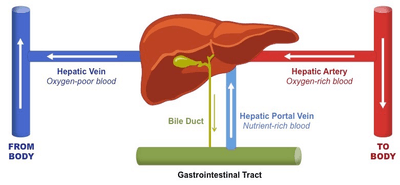
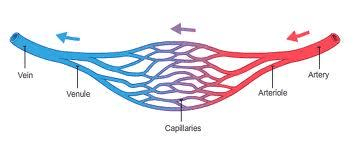

## Blood Vessels

<table> <thead> <tr> <th>Vessel</th> <th>Function</th> <th>Structure</th> </tr> </thead> <tbody> <tr> <td rowspan=3>Arteries</td> <td rowspan=3>Transport high-pressure blood away from heart</td> <td>Elastic tissue walls stretch and relax as blood is forced out; causes pulse</td> </tr> <tr> <td>Thick walls to withstand high pressure</td> </tr> <tr> <td> Small lumen maintains (high) blood pressure.</td> </tr> <tr> <td rowspan=3>Veins</td> <td rowspan=3>Transport low pressure blood to the heart</td> <td>Valves prevent backflow of blood.</td> </tr> <tr> <td>Blood is at low pressure, but nearby muscles squeeze veins and help push blood to the heart</td> </tr> <tr> <td>Large and wide lumen to reduce resistance to the flow of blood</td> </tr> <tr> <td rowspan=3>Capillaries</td> <td rowspan=3>Allow substances to diffuse into cells</td> <td>One cell thick wall for easy diffusion</td> </tr> <tr> <td>Highly branched; large surface area</td> </tr> <tr> <td>Capillary beds constantly supplied with fresh blood, so diffusion occurs</td> </tr> </tbody> </table>

### **Major Blood Vessels**

**Heart**: Vena Cava, Aorta, Pulmonary Arteries & Vein

**Lungs:** Pulmonary Arteries and veins

**Kidney:** Renal Arteries and veins

**Liver:** Hepatic Artery, Hepatic Veins and Hepatic Portal Vein

* The **hepatic artery** brings oxygenated blood from the heart to the liver
* The **hepatic vein** brings deoxygenated blood from the liver back to the heart
* The **hepatic portal vein** carries blood from the gastrointestinal tract, gallbladder, pancreas and spleen to the liver. This blood contains nutrients and toxins extracted from digested contents.

  

### **Arterioles and Venules**

* The vessels that connect arteries to capillaries are called **arterioles**
* The vessels that connect capillaries to veins are called **venules**