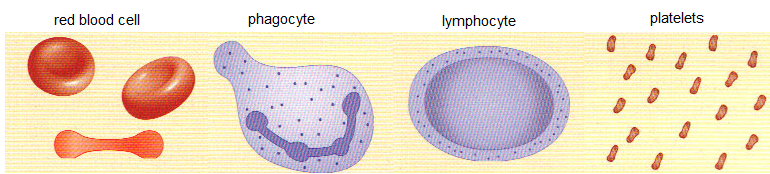

## Blood

* **Red blood cells**: biconcave shape, haemoglobin and oxygen transport (oxy-haemoglobin)
* **White blood cells**: phagocytosis and antibody production
* **Platelets**: allows/promotes blood clotting
* **Plasma**: transport of blood cells, ions, nutrients, urea, hormones and carbon dioxide (mostly water and dissolved substances)

> **Syllabus 9.4.2**: You must be able to identify red and white blood cells in photomicrographs and diagrams

 

### **White Blood Cells**

| Phagocyte | Lymphocyte |
|----|----|
| Phagocytes have lobed/irregular C-shaped nuclei and vesicles containing digestive enzymes. | Lymphocytes have a circular nucleus and are found in blood |
| Phagocytosis: engulfs pathogen, vesicles fuse with the vacuole, enzymes digest bacteria. | Large nucleus/small cytoplasm, and they produce antibodies, |
| **Antigens**: protein/carbohydrate on the surface of the pathogen which provokes the immune system | **Antibodies**: Y-shaped proteins bind to label pathogens, marking them for destruction by the phagocytes. |

### **Blood Clotting**

* Reduces blood loss and keeps pathogens out
* Fibrinogen (inactive) turns to fibrin (activated), forms a mesh to trap red blood cells, and eventually dries to form a scab.

