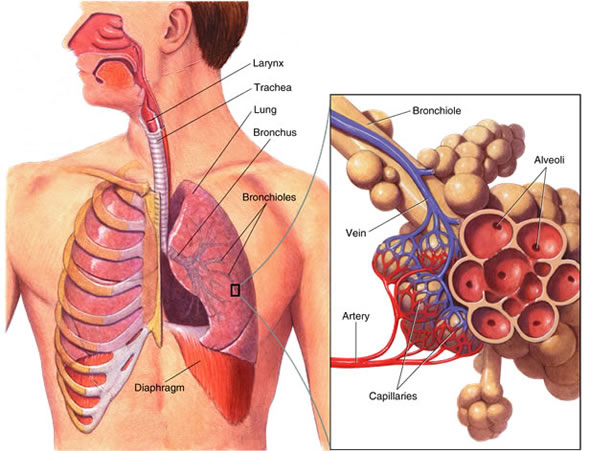

## Structure of the Lungs

The lung contains a diaphragm, ribs, intercostal muscles, larynx, trachea, bronchi, bronchioles, alveoli and associated capillaries

* **Cartilage (in the trachea):** prevents the trachea from collapsing during the absence of air and protects it by keeping it open.
* **Ribs:** to protect vital organs and blood vessels and expand and contract (and efficient breathing).
* **Intercostal (internal & external) muscles:** situated between the ribs that create and move the chest wall.
* **Diaphragm:** produces volume and pressure changes in the thorax, leading to the ventilation of the lungs.

### **Composition of Breathing Dry Air**

|    | Inspired Air | Expired Air |
|----|----|----|
| Oxygen | 21% | 16% |
| Carbon Dioxide | 0.04% | 4% |
| Nitrogen | 78% | 78% |
| Water Vapour | Lower | Higher |

* **Test for CO2:** Add CO2 through limewater. +ve result = turns cloudy

