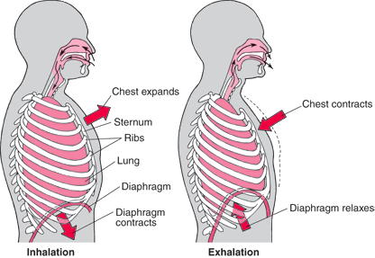

## Breathing

| Inspiration | Expiration |
|----|----|
| External intercostal muscles contract – pulls ribcage upwards and outwards | External intercostal muscles relax – ribcage falls downwards and inwards |
| Diaphragm muscles contract – the diaphragm moves downwards, and the volume of the thorax increases | Diaphragm muscles relax – return to a dome shape, and the volume of the thorax decreases |
| Atmospheric Pressure > Pressure in Thorax | Atmospheric Pressure < Pressure in Thorax |
| Air moves into the lungs | Air moves out of the lungs |

 

* **Internal intercostal muscles** are used in coughing and sneezing.
* **Mucus & cilia:** goblet cells produce sticky mucus to trap and
  eliminate particulate matter and microorganisms.
* **Ciliated cells** have cilia, little hairs which sweep/beat back and forward in a coordinated way to brush mucus up the lungs into the mouth.

