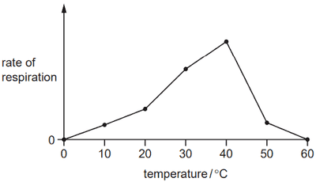

# Respiration

## Respiration

**Respiration:** Chemical reactions that break down nutrient molecules in living cells to release energy.

* Uses of energy in the body of humans: muscle contraction, protein
  synthesis, cell division, active transport, growth, the passage of
  nerve impulses and the maintenance of a constant body temperature.
* Respiration involves the action of **enzymes** in cells to speed up the reaction.

### **Effect of Temperature on Respiration in Yeast**

* An indicator, **Methylene Blue**, can be used to investigate the effect of temperature on yeast cells.
* Yeast can respire both aerobically and anaerobically, though, in this experiment, their aerobic respiration rate is being investigated.
* The time taken for the methylene blue to lose its colour measures the respiration rate of the yeast cells in the suspension.
  * The faster the dye changes from blue to colourless, the faster the respiration rate.
* IV: Effect of Temperature
* DV: Rate of Respiration (recording the **time taken** for methylene blue dye to change from **blue to colourless)** 

> **Exam Tip!** In the exam, always state that energy is **released**; it is NEVER made, produced, or created.

