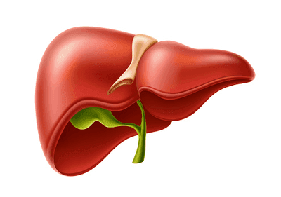

## Function of Liver

The role of the liver is in the **assimilation** of amino acids by converting them to proteins.   **Deamination**:  A critical process involving the removal of an amino group (-NH2) from a molecule, usually an amino acid. This reaction mostly takes place in the liver and is an essential part of the body's metabolism of proteins and nitrogen.

**Assimilation**: uptake and use of nutrients by body cells

* Urea is formed in the liver from excess amino acids.
* Alcohol, drugs & hormones are broken down in the liver.