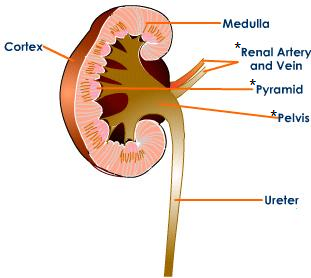
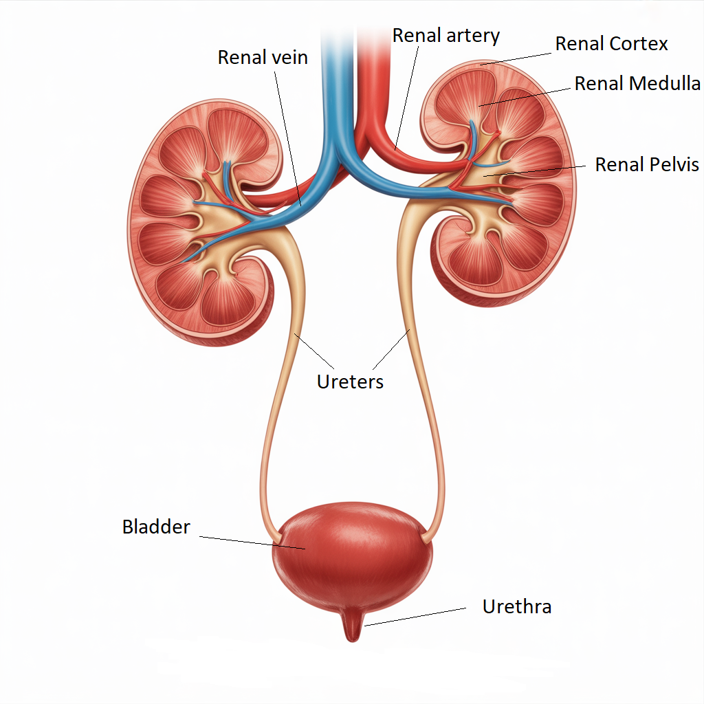

## Function of Kidney

* Removal of urea and excess water and the re-absorption of glucose
  and some salts

* **Cortex:** contains Bowman’s capsules and coiled tubules.
* **Ureter:** carries urine from the kidney to the bladder
* **Medulla:** has loops of Henlé and collecting ducts
* **Urethra:** carrying urine from the bladder to the outside.
* **Bladder:** stores urine
* **Renal artery:** brings wastes and water from the blood
* **Renal vein:** reabsorbs water and functional molecules and leaves wastes behind