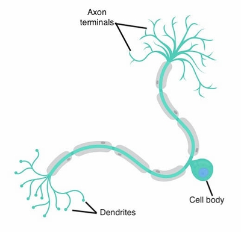
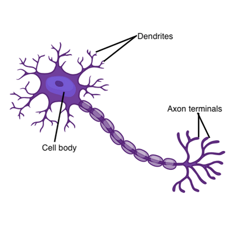
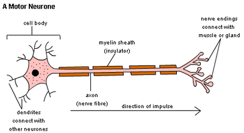

## Types of Neurones

**Nerve Impulse:** an electrical signal that passes along the nerve cells called **neurones**

**Axons**: Ensure less time is wasted when the impulse is transferred from one neurone to another

**Dendrites**: Extensions which form a network for easy communication.

### 

### **Sensory Neurone**

* Carry impulses from the **sense organs (sensory receptors) to the CNS**.

### **Relay Neurone (Interneurone)**

* The middleman inside the CNS connects sensory to motor neurones.

### **Motor Neurone**

* Carry impulses from the **CNS to effectors** (muscles or the glands)

