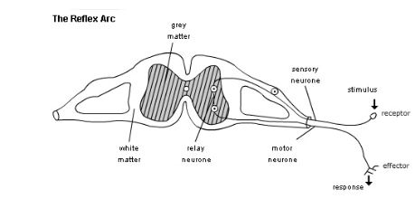

## Simple Reflex Arc

**Reflex Action:** automatically and rapidly integrates and coordinates the stimuli with the responses of effectors (muscles and glands).

* E.g. quickly removing your hand from the hot metal surface
* They involve three neurones: a sensory neurone, a relay neurone and a motor neurone.
* The gap between neurones is called a synapse.
* **How the simple reflex arc works:**
  * A stimulus affects a receptor (cell or organ that converts a
    stimulus into an electrical impulse)
  * A sensory neurone carries impulses from the receptor to the CNS (spinal cord)
  * Connector/relay neurone carries impulse slowly (because it has no myelin sheath) across the spinal cord
  * The motor neurone carries impulses from the CNS to the effector
  * The effector (either a muscle or a gland) carries out the response

### Flowchart of the reflex arc:

[Stimulus] → [Receptor (eg. in skin)] → [Sensory Neuron] → [Relay Neuron (in spinal cord)] → [Motor Neuron] → [Effector (e.g. Muscle)] → [Response (e.g. Pulling hand away)]

### Simulation of reflex arc:

<https://explore.ludenso.com/experiences/7bab438966df4691104408dc893d6cb5/enrichments/8ae80d8f4d664729c11e08dc893be4e6/embed/>