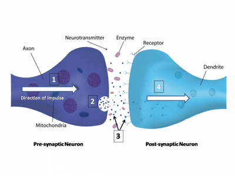

## Synapse

**Synapse:** a junction between two neurones, consisting of a gap across which impulses pass by diffusion of a neurotransmitter  

* The synapses ensure that impulses travel in **one direction only**.
* **Synaptic cleft:** the small gap between each pair of neurones
* Inside the neurone’s axon, there are 100s of tiny vacuoles (**vesicles**, each containing a chemical called neurotransmitter)
* When an impulse arrives, the vesicles move to the cell membrane and empty their content into the synaptic cleft.
* The neurotransmitter quickly diffuses across the tiny gap and attaches to receptor molecules in the cell membrane of the relay neurone.
* This can happen because the neurotransmitter molecules' shape complements the receptor shape.

### Simulation of how synapse works:

<https://explore.ludenso.com/experiences/7bab438966df4691104408dc893d6cb5/enrichments/f1c6cda504c446d5c11f08dc893be4e6/embed/>