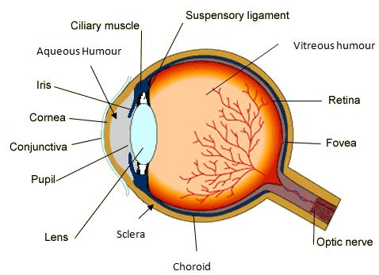

## Sense Organs

**Sense Organ:** groups of receptor cells responding to specific stimuli: light, sound, touch, temperature, and chemicals.

* **Cornea:** refracts light
* **Iris:** controls how much light enters the pupil
* **Lens:** focuses light onto the retina
* **Retina:** contains light receptors, some sensitive to light of different colours (Rods and cones)
* **Optic nerves:** carry impulses to the brain
* **Pupi**l: A hole which allows light to enter

