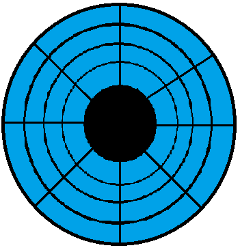

## Pupil Reflex

* Adjusting for high and low light intensity
* An involuntary response

|    | Low Light Intensity | High Light Intensity |
|----|----|----|
| Radial Muscles | Contract | Relax |
| Circular Muscles | Relax | Contract |
| Pupil Size | Wide | Narrow |
| Amount of Light Entering | More | Less |

