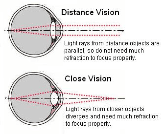

## Accommodation

**Accommodation**: Adjusting for near and distant objects.

* The way the **lens** brings about **fine focusing** is called **accommodation**
* The lens is **elastic,** and its shape can be changed when the **suspensory ligaments** attached to it become **tight** or **loose**
* The contraction or relaxation of the ciliary muscles brings about the changes

|    | Near Object | Distant Object |
|----|----|----|
| Ciliary muscles | Contract | Relax |
| Suspensory Ligaments | Slack | Tighten |
| Lens | Short and fat | Long and thin |

 

### **Example Past Year Question**

**Explain why a person cannot focus on distant objects if the suspensory ligaments become permanently overstretched**. (0610/42/F/M/23)

1. ciliary muscles relax
2. suspensory ligaments can no longer become tight
3. the lens is not stretched/remains wide
4. the angle of refraction remains unchanged

