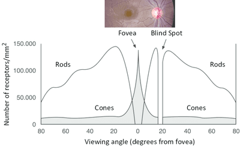

## Rods and Cones

| Rods | Cones |
|----|----|
| Provide low detail, black & white images, suitable for seeing in low-intensity light (at night). | Provide detailed, coloured images; they work in high light intensity. |
| Packed most tightly around the edge of the retina, so you can see things most clearly when not looking directly at them. | Most tightly packed at the retina's centre, objects are seen most clearly when directly looking at them. |

* **Fovea:**
  * Part of the retina where the receptor cells are pushed most closely together
  * Where light is focused when you look straight at an object
* **Distribution of Rods and Cones** 
  * More rod cells than cone cells
  * A number of cone cells peaked in the middle, showing the location of the fovea. No rod cells are present in the peak.
  * No rod and cone cells at the blind spot, as the optic nerve is located there. \n  

