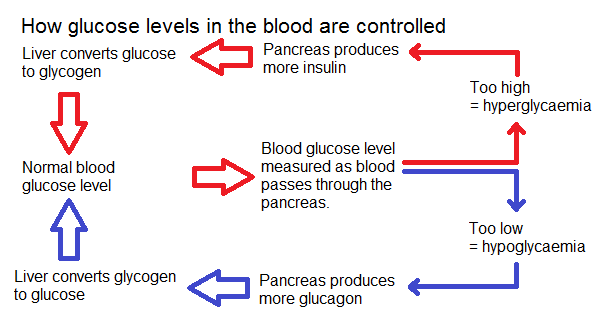

## Homeostasis: Blood Glucose Control

* Blood glucose levels are monitored and controlled by the pancreas
* The pancreas produces and releases different hormones depending on
  the blood glucose level
* Insulin is released when blood glucose levels are high – the liver
  stores excess glucose as glycogen
* Glucagon is released when blood glucose levels are low – the liver
  converts stored glycogen into glucose and releases it into the blood

* When the control of blood glucose does not work, a person is said to have diabetes

### **Type 1 Diabetes**

**Type 1 Diabetes**: caused by the death of the cells that secrete insulin.

* **Symptoms:** hyperglycaemia (feeling unwell, dry mouth, blurred vision, and thirsty) or hypoglycaemia (tired, showing confusion and irrational behaviour)
* **Treatment:** eating little and often and avoiding large amounts of carbohydrates, injecting insulin to reduce blood glucose concentration

