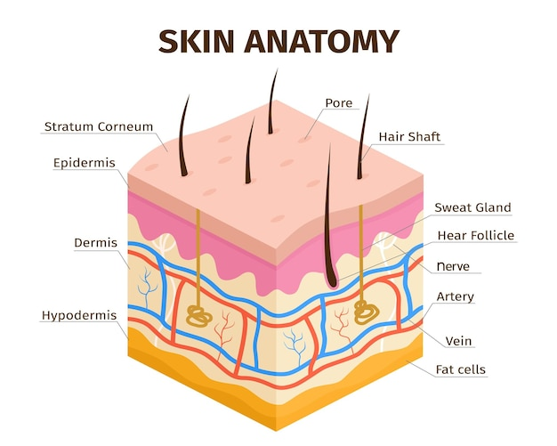
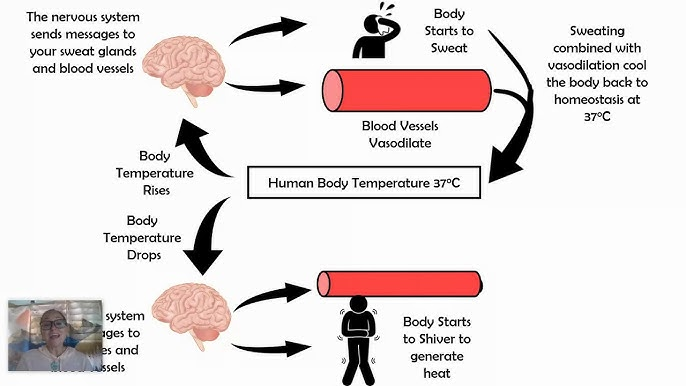
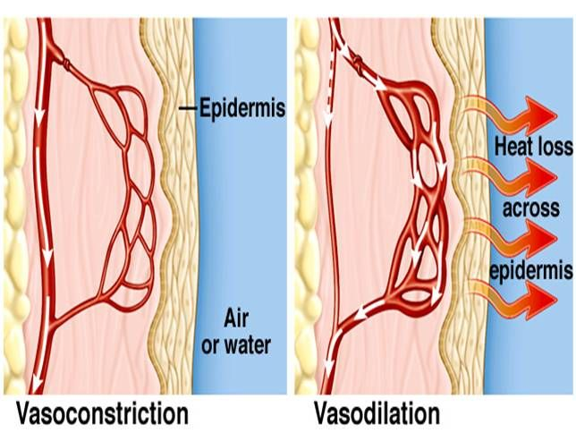

## Homeostasis: Temperature Regulation

Control of body temperature is a **homeostatic mechanism**

- The human body maintains the temperature at which enzymes work best, around 37°C
- If body temperature increases over this temperature, enzymes will denature and become less effective at catalysing reactions such as respiration

### **The Structure of the Skin**

### **Temperature Regulation by The Skin**

- Regulation is controlled by the brain which contains thermoreceptors (sensitive to the temperature of the blood)

- The skin also has thermoreceptors and sends nervous impulses to the brain via sensory neurones

- The brain responds to this information by sending nerve impulses to the motor neurones, then to the effectors in the skin to maintain the temperature within a narrow range of the optimum, 37°C

- Fatty tissue under the dermis acts as a layer of insulation to prevent too much body heat from being lost through the skin

### **Vasoconstriction and Vasodilation**

**Vasoconstriction**: blood flow in capillaries slows down because arterioles leading to the skin capillaries get narrower when we are **cold**.

- This reduces the amount of heat lost from the blood by radiation as less blood flows through the surface of the skin

**Vasodilation**: blood flow in capillaries increases because blood vessels to the skin capillaries get wider when we are **hot**.

- This cools the body as blood (which carries heat around the body) flows at a faster rate through the skin’s surface and so more heat is lost by radiation

