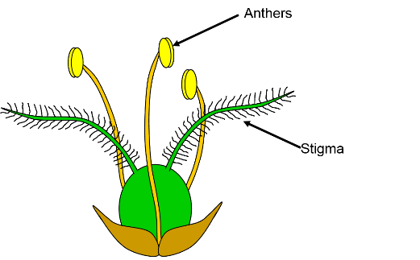

## Parts of a Flowering Plant

* Flowers are the **reproductive organ** of the plant
* They usually contain both male and female reproductive parts
* The structure of insect and wind-pollinated flowers are slightly different as each is adapted for their specific function

### **Insect Pollinated Flowers**

* Have bright petals and sweet scents to attract insects looking for nectar

* Produce sticky/spiky pollen which stick to the insects

### **Wind Pollinated Flowers**

* Small and lightweight pollen allowing them to be easily carried by the wind

* Lack bright colour and scents as they do not attract insects

* Feathery stigma to catch pollen

### **Functions**

* **Sepal:** protect the flower bud.
* **Petal:** brightly coloured and scented and may have nectars, which are all used to attract insects. Petals in wind-pollinated flowers are tiny and used for pushing the bracts (leaf-like structures) apart from exposing stamens and stigma.
* **Anther:** has pollen sacs with pollen grains that contain the male nucleus (male gamete).
* **Stigma:** platform on which pollen grains land
* **Ovary:** hollow chamber, ovules grow from the walls.