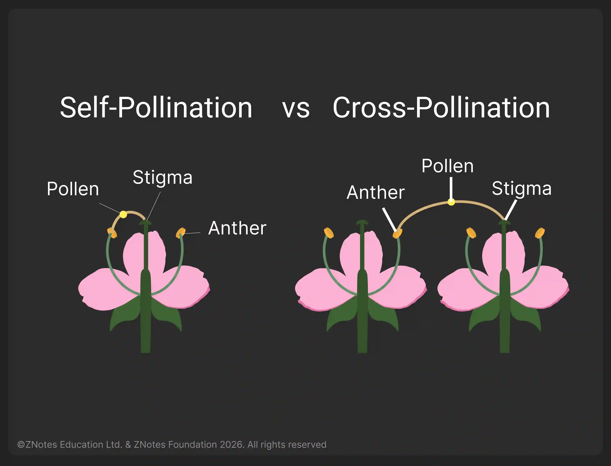

## Pollination

**Pollination:** transfer of pollen grains from the male part of the plant (anther of stamen) to the female part of the plant (stigma).

* **Agents of pollination:** insects, birds, mammals, water and wind
* Fertilisation occurs when a pollen nucleus fuses with a nucleus in an ovule

|Insect Pollinated|Wind Pollinated|
|:---|:---|
|Bright, colourful petals – attract insects|Dull petals|
|Sweetly scented|No scent|
|Contains nectar|No nectaries|
|A moderate amount of pollen|Huge amount of pollen|
|Pollen is spiky/sticky, large in size|Pollen round and smooth, Small and light|

* **Pollen tube:** pollen grain lands on the stigma and creates a tunnel down the style, through the micropyle to ovules.
* **Ovule**: seed
* **Ovary**: fruit

### **Self Pollination**

**Self Pollination**: the transfer of pollen grains from the anther of a flower to the stigma of the same flower or a different flower on the same plant.

|Advantages|Disadvantages|
|:---|:---|
|Genetically identical|Lack of genetic variation|
|High chance of successful pollination|Increases competition between plants|
|Fast and saves time|Susceptible to the same disease|

### **Cross-Pollination**

**Cross-pollination**: the transfer of pollen grains from the anther of a flower to the stigma of a flower on a different plant of the same species.

|Advantages|Disadvantages|
|:---|:---|
|Increases variation|Reliance on pollinators|
|Quick to adapt to surroundings|Wastage of pollen|
|Less susceptible to diseases|More energy required|

