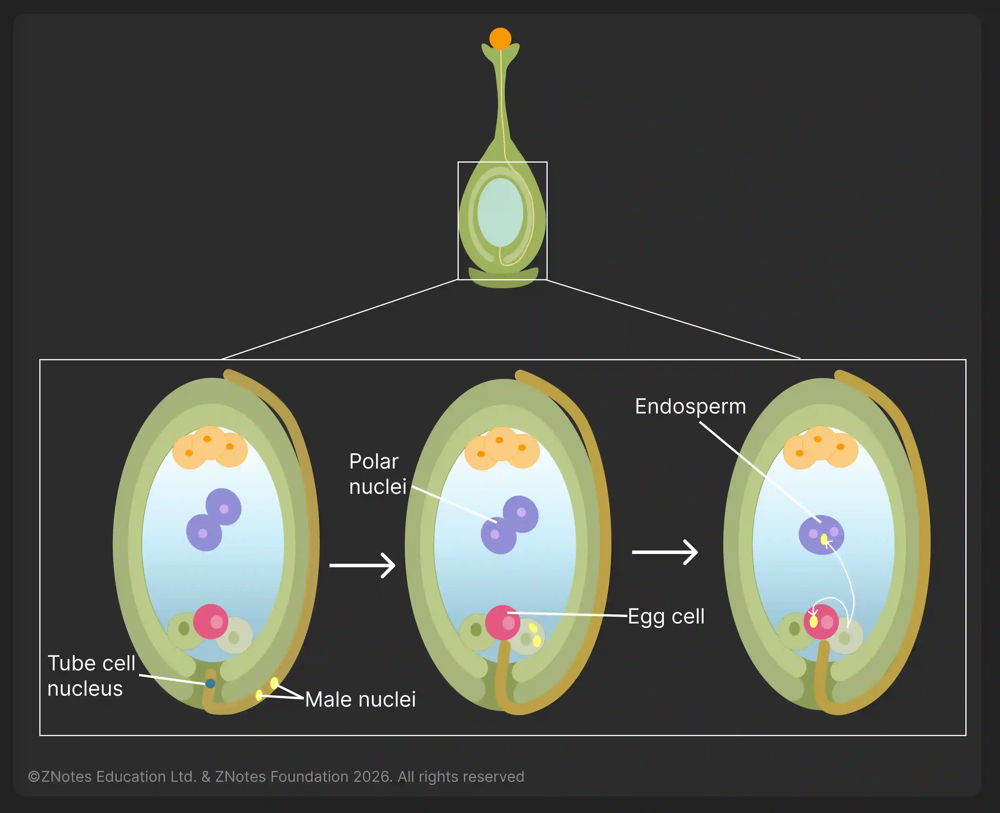

## Fertilisation in Plants

* Pollen tube growing from a pollen grain
* Pollen (tube/grain) releases enzymes
* The pollen tube then grows down the style/grows into the ovary
* Pollen nucleus travels down the pollen tube
* Pollen tube grows and moves through the micropyle into the ovule
* Fertilisation occurs
* The pollen nucleus fuses with the female nucleus
* A zygote is formed