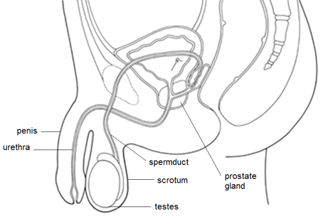
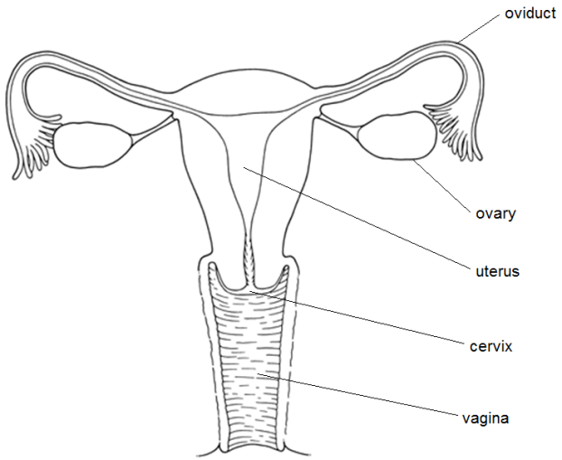

## Sexual Reproduction In Humans

### **Male Reproductive System**

* **Testes:** have many coiled tubes that produce sperm, and the cells between tubes produce testosterone.
* **Scrotum:** holds testicles
* **Sperm duct:** carries sperm from testicles to urethra.
* **Prostate gland:** makes seminal fluid
* **Urethra:** carries semen from the sperm duct to the tip of the penis
* **Penis:** male sex organ used to transfer semen to the female.

### **Female Reproductive System**

* **Ovary:** contains follicles that develop into the ova and produces progesterone and oestrogen
* **Oviduct (fallopian tube):** carries the ovum to the uterus
* **Uterus (womb):** where the fetus develops.
* **Cervix:** neck of the uterus: a robust and rigid muscle, moist by mucus with a small opening
* **Vagina:** receives the penis during intercourse and way out for baby at birth. Moist tube of muscle, flexible and secretes mucus

