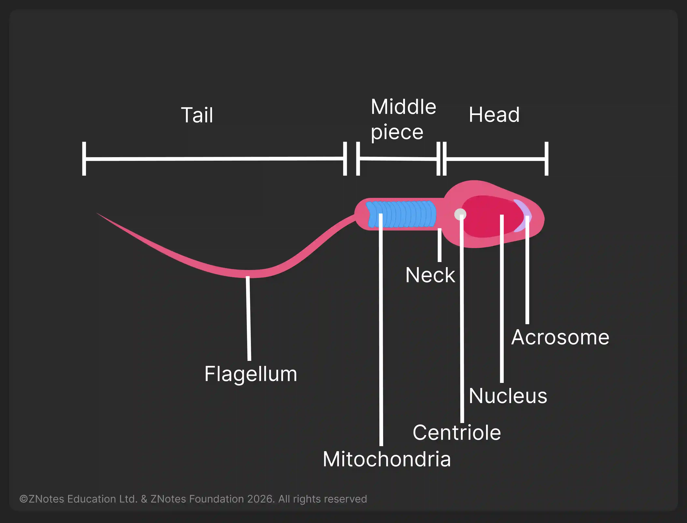
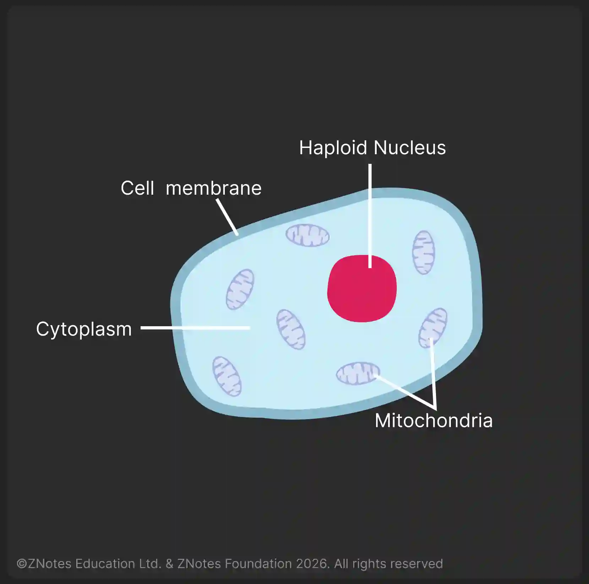

## Adaptive Features of Gametes

### **Sperm (Male Gamete)**

1. Small in size

2. Elongated and streamlined with energy storage

3. Millions in numbers containing 23 chromosomes

   

|Features|Functions|
|:---|:---|
|Flagellum|Propels the sperm to swim|
|Mitochondria|Respiration to release energy for swimming|
|Enzymes in the acrosome|Release digestive enzymes to digest the jelly coat|

### **Egg Cell (Female Gamete)**

1. Larger in size
2. Spherical protein/fat in the cytoplasm
3. Moves with the help of cilia
4. Released once per month containing 23 chromosomes   

|Features|Functions|
|:---|:---|
|Energy storage|Development of zygote|
|Jelly coat|Changes at fertilisation|
