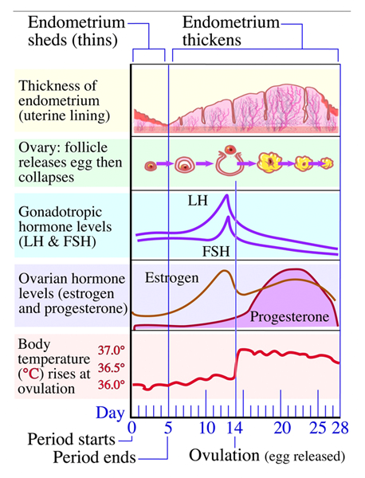

## The Menstrual Cycle

**Day 1 to 5:**

* In the ovary, *FSH* secreted by the *Pituitary Gland* to stimulate the maturation of ONE *follicle* in the ovary.
* In the uterus: the *endometrium* breaks down; menstruation
* **Day 5 to 12:**
  * In the ovary, the follicle keeps maturing
  * In the uterus, *oestrogen* is secreted by *follicle* and the ovarian tissues to prepare the *endometrium*
* **Day 13/14/15:**
  * In the ovary, *LH* is also secreted by the *Pituitary* *Gland* to trigger the release of the egg from the follicle into the fallopian tube. Ovulation happens on **Day 14**.
* **Day 15 to 28:**
  * In the ovary, LH causes the empty follicle to turn into a Corpus Luteum.
  * The Corpus Luteum produces progesterone, a hormone
  * In the uterus, progesterone keeps the lining (endometrium) thick, in case a fertilised egg (embryo) needs to implant.
* **Day 28 – Scenario 1:** Egg not fertilised
  * No implantation takes place, and the *Corpus Luteum* degenerates, causing a lack of progesterone.
  * This means that *endometrium* is no longer kept thick, the cycle returns to Day 1
* **Day 28 – Scenario 2:** The egg is fertilised
  * Implantation occurs.
  * This makes the hormones keep the *Corpus Luteum* maintained, which means that *progesterone* is high.
  * This keeps the *Endometrium* thick for pregnancy

