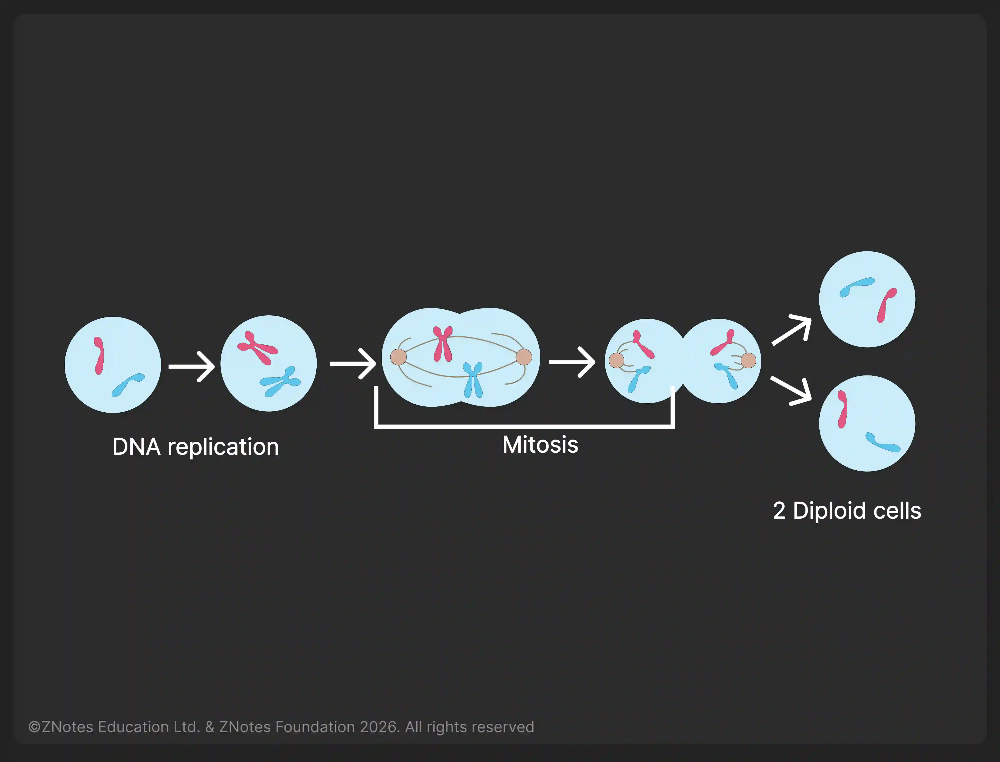

## Cell Division: Mitosis

**Mitosis:** The nuclear division gives rise to genetically identical cells    

* Mitosis is needed for:
  * **Growth:** in animals, each tissue provides its own new cells when needed.
  * **Repair** damaged tissues: for example, when you cut your skin, mitosis provides new cells to cover up cuts.
  * **Replacement** of worn-out cells
  * **Asexual reproduction:** in plants
* The exact replication of chromosomes occurs before mitosis
* During mitosis, the copies of chromosomes separate, maintaining the chromosome number in each daughter cell

**Stem Cells:** unspecialised cells that divide by mitosis to produce daughter cells that can become specialised for specific functions