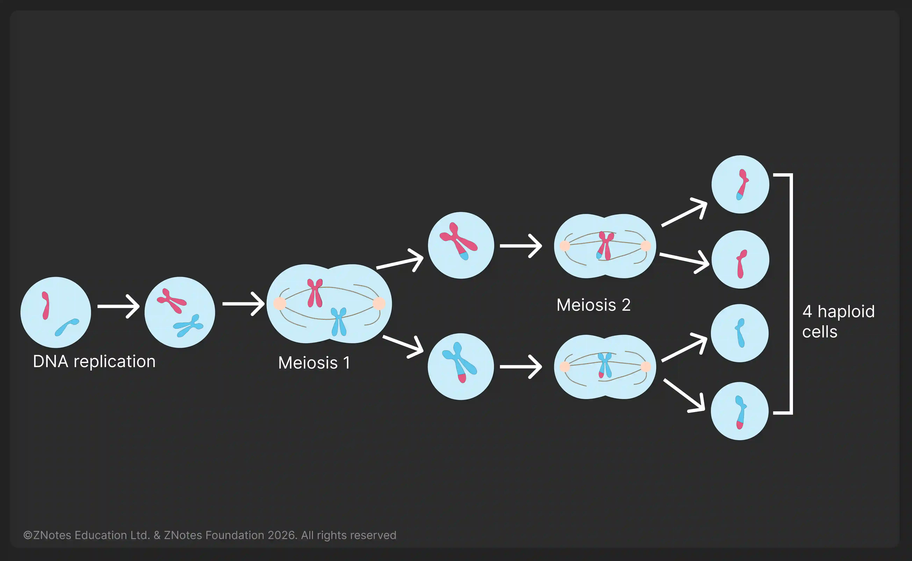

## Cell Division: Meiosis

**Meiosis**: Reduction division in which the chromosome number is halved from diploid to haploid   

* Meiosis is involved in the production of gametes.
* Meiosis results in genetic variation, so the cells produced are not all genetically identical.
* Gametes such as sperm and ovum are produced via meiosis.