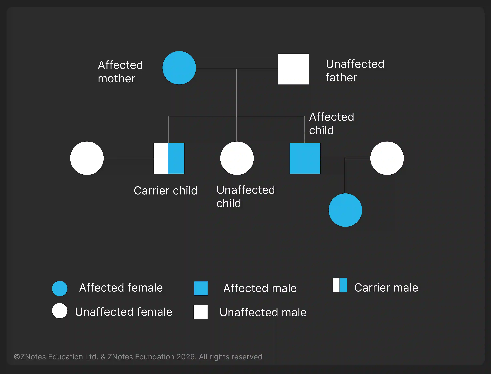
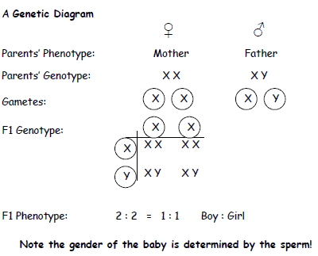
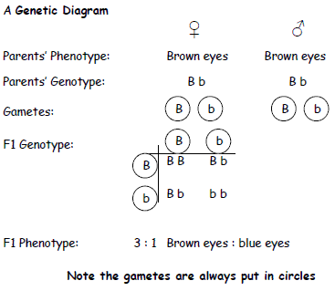

## Monohybrid Inheritance

**Inheritance:** The transmission of genetic information from parent to offspring.

* Here are some common terminologies you should know to understand monohybrid inheritance.

### **Terminologies**

* **Genotype:** the genetic makeup of an organism in terms of the alleles present (e.g. Tt or GG)

* **Phenotype:** the observable features of an organism (e.g. tall plant or green seed)

  *genotype + environment + random variation → phenotype*

* **Homozygous:** having two identical alleles of a particular gene (e.g. TT or gg). Two identical homozygous individuals that breed together will be pure-breeding

* **Heterozygous:** having two different alleles of a particular gene (e.g. Tt or Gg), not pure-breeding

* **Dominant:** an allele that is expressed if it is present (e.g. T or G).

* **Recessive:** an allele that is only expressed when there is no dominant allele of the gene present (e.g. t or g)

### **Pedigree Diagram**

* Pedigree diagrams trace the **inheritance pattern** of a specific characteristic (usually a disease) **through generations of a family.**
* **Pure Breeding:** The individual is homozygous for that characteristic
* This can determine the probability that someone in the family will inherit the genetic disorder.

### **Genetic Diagrams**

* Monohybrid Inheritance can be determined using a genetic diagram known as a **Punnett square.**
* A Punnett square diagram shows the **possible combinations of alleles** that could be produced in the offspring.
* The **dominant allele** is shown using a capital letter, and the **recessive allele** uses the same letter but lowercase.
* If you are asked to use your own letters to represent the alleles in a Punnett square, try to choose a letter that is obviously different as a capital than the lowercase so the examiner is not left doubt as to which is dominant and which is recessive.

**1:1 Monohybrid Crosses**

* In this cross, there is a **1:1 ratio of boy to girl**, meaning a **50%** chance of the offspring being a boy and a **50%** chance of the offspring being a girl.

**3:1 Monohybrid Crosses**

* There is more variation in this cross, with a **3:1** ratio of brown eyes: blue eyes, meaning each offspring has a 75% chance of having brown eyes and a 25% chance of having blue eyes

### Example: Inheritance of flower colour

* Let the Purple flower (P) be dominant, and the White flower (p) be recessive

* First Cross (Parent Generation): Parent 1 (PP) x Parent 2 (pp)

  * All offspring will be Pp, which are all purple flowers

  * This is the F1 generation

* Second cross: Pp x Pp

  * Possible Allele Combinations:

    * PP (homozygous dominant)

    * Pp (heterozygous)

    * pp (homozygous recessive)

  * Phenotypes

    * 3 Purple-flowered plants (PP, Pp, Pp)

    * 1 White-flowered plant (pp)