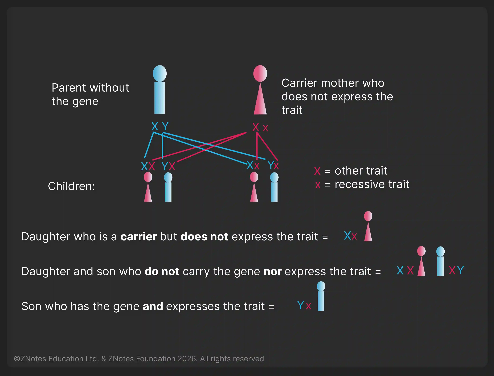

## Modification of Mendelian Genetics

### **Codominance**

**Codominance**: a condition where two alleles of a gene are **equally dominant (50%)**

* Both alleles are equally expressed in the phenotype of the heterozygote.
* For example, if the parent phenotype is red and white, a co-dominant will have both red and white colour in the offspring.

### **ABO Blood Group (Codominance and Multiple Allele)**

* Inheritance of blood group is an example of codominance
* There are three alleles for the blood group given by the symbols IA, IB and IO.
* IA and IB are co-dominant giving blood group AB or IAIB, and both dominant to IO.

### **Sex-Linked Characteristics**

**Sex-linked characteristic:** a characteristic in which the gene responsible is located on a sex chromosome, making it more common in one sex than in the other.

* Generally, in the IGCSE syllabus, the most common is **X-linked recessive trait**.
* X-linked recessive disorders are more common in males than in females.

> **Syllabus 17.4.18**: You must be able to use genetic diagrams to predict the results of monohybrid crosses involving codominance or sex linkage and calculate phenotypic ratios.