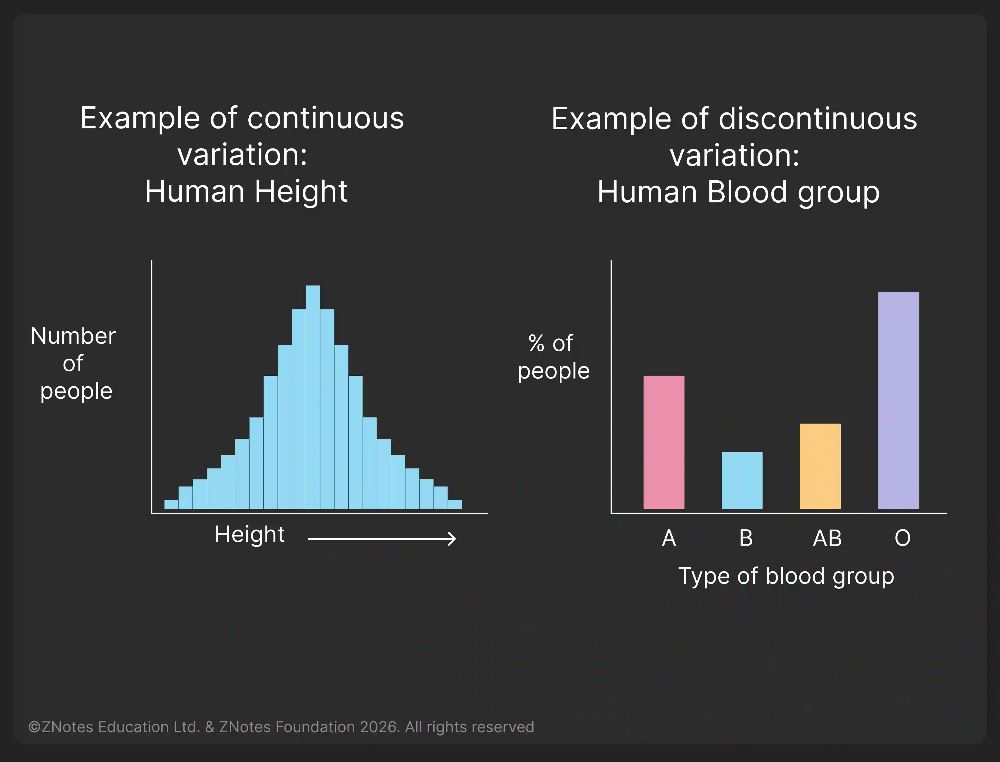
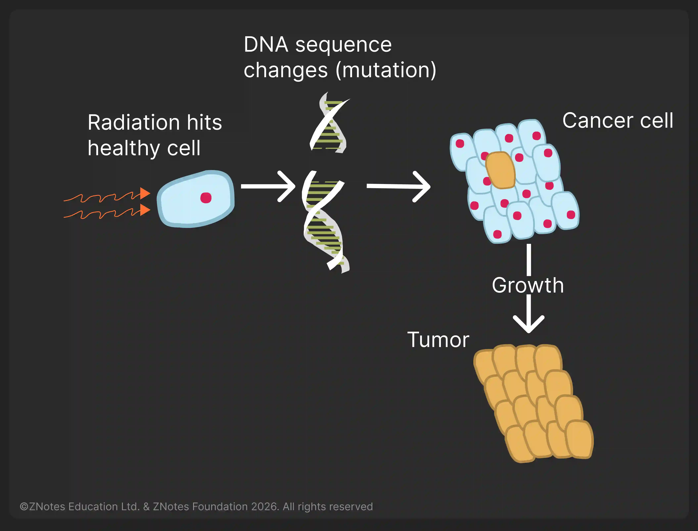

# Variation and Selection

## Variation

* **Variation:** differences between individuals of the same species

* Both genetic and environmental factors cause phenotypic variation

* **Continuous Variation:** results in a range of phenotypes between two extremes; examples include body length and body mass

* **Discontinuous Variation:** results in a limited number of phenotypes with no intermediates (e.g. ABO blood groups, seed shape in peas and seed colour in peas)

* **Continuous variation** is caused by genes and the environment

* **Discontinuous variation** is usually caused only by genes

**Syllabus 18.1.5**: You must be able to investigate and describe examples of continuous and discontinuous variation

### **Mutation**

**Mutation:** A genetic change.

* **Gene Mutation:** a change in the base sequence of DNA
* Mutation is the way in which new alleles are formed
* **Mutation, meiosis, random mating and random fertilisation** are sources of genetic variation in populations
* Ionising radiation and some chemicals increase the rate of mutation      

  