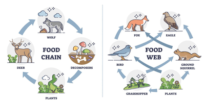
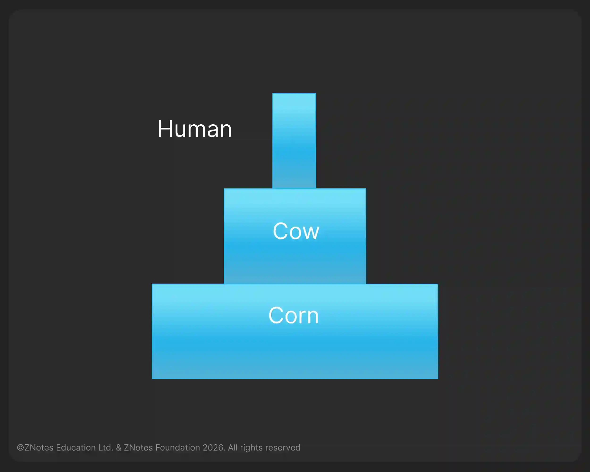
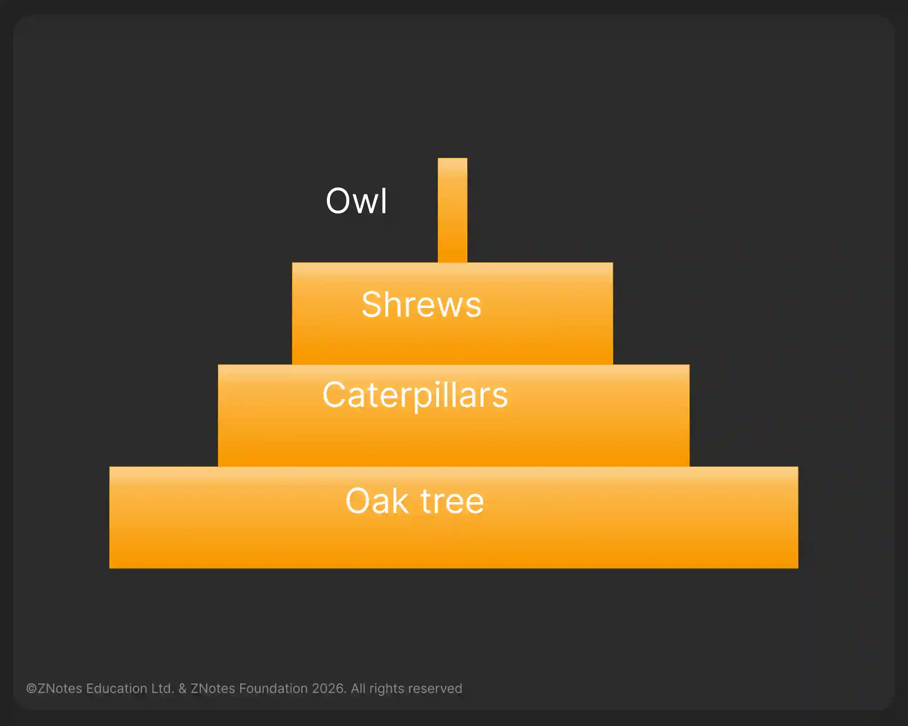

# Organisms and their Environment

## Energy Flow

* The sun is the principal source of energy input to biological systems.
* Energy flow is **NOT** a cycle; it starts from the sun, and then that energy is harnessed by plants, which are eaten by animals, which other animals eat.
* At each step, energy is lost to the environment.

## Food Chains and Food Webs

**Food Chain:** a chart showing the flow of energy (food) from one organism to the next, beginning with a producer, for example:

**Food Web:** showing a network of interconnected food chains.     

* Energy is transferred between organisms in a food chain by
  ingestion
* **Producer:** an organism that makes its organic nutrients, usually using energy from sunlight through photosynthesis
* **Consumer:** an organism that gets its energy by feeding on other organisms.
  * Consumers may be classed as **primary, secondary, tertiary and quaternary** according to their position in a food chain
* **Herbivore:** an animal that gets its energy by eating plants
* **Carnivore:** an animal that gets its energy by eating other
  animals
* **Decomposer:** an organism that gets its energy from dead or waste
  organic matter (i.e. a saprotroph)
* **Trophic level:** the position of an organism in a food chain, food web or ecological pyramid.
  * **Primary consumer:** eat vegetables
  * **Secondary consumer:** eat meat/drink milk
  * **Tertiary consumer:** eat a predatory fish, salmon

**Food chains usually have fewer than five trophic levels because energy transfer is inefficient:**

* Sun produces light, and less than 1% of the energy falls onto leaves.
* Producers ‘fix’ only about 5-8% of that energy because of transmission, reflection and incorrect wavelength.
* Primary consumers only get between 5-10% because some parts are indigestible (e.g., cellulose) and do not eat the whole plant.
* The secondary consumer gets between 10-20% because the animal matter is more digestible & has a higher energy value.
* At each level, heat is lost by respiration.

**Humans eating plants is more efficient than humans eating animals because:**

* We need only a couple of vegetables to have one meal but to have the meat, we must feed the animal a lot of plant material to get far less meat.
* When raising an animal, plants lose energy to the environment. Then, the animal loses energy to the environment and does not use up all the plant material, so it is inefficient.

### **Ecological Pyramids**

|Pyramid of Numbers|Pyramid of Biomass|
|:---|:---|
|||
|Shows the number of each organism in a food chain|Pyramid, which shows the biomass|
|When moving up the pyramid, the number of individuals decreases|(number of individuals × their individual mass)|

The pyramids of biomass are **always** pyramid-shaped or upright.