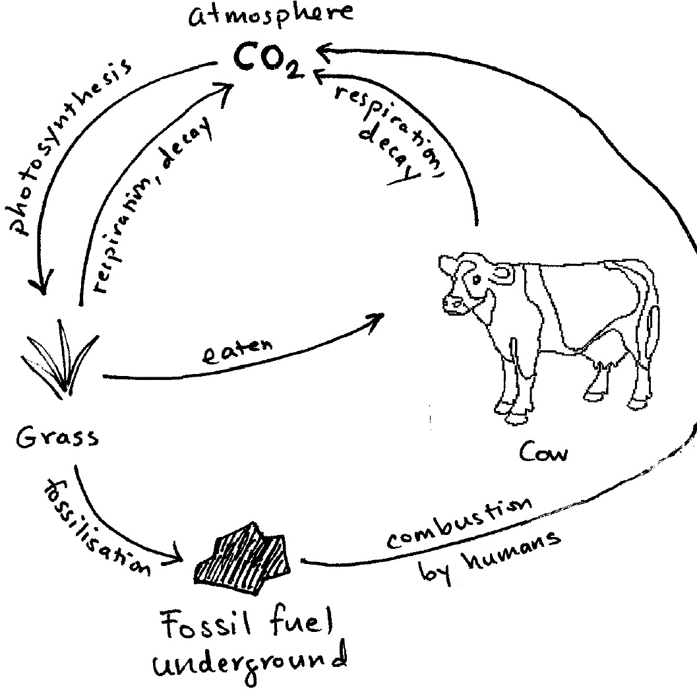
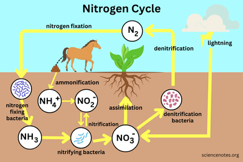

## Nutrient Cycles

### **Carbon Cycle**

* Carbon is taken from the atmosphere by photosynthesis (plants)
* It is passed on to animals and decomposers by feeding.
* It is returned by respiration in plants and animals and decomposed by microorganisms.

> Fossilisation is **NOT** needed anymore - from 2023 onwards

### **Nitrogen Cycle**    

* **Nitrogen-fixing bacteria** provide usable nitrogen for plants; these may exist in the root nodules where they live in symbiosis with the plants (nitrogen fixation), or this can happen because of lightning or microorganisms providing them through decomposition.
* **Nitrifying bacteria** convert nitrogen-containing substances into nitrates for the plants (nitrification).
* Plants absorb these substances and convert them into proteins
* Death and decay happen at each trophic level, leading to stage one
* **Denitrifying bacteria** carry out denitrification: they convert nitrogen-containing substances into atmospheric nitrogen

