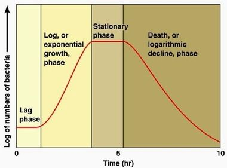

## Sigmoid Curve of Population Growth

* **Lag phase:** The number of mature, reproducing individuals is low and they may be widely dispersed
* **Exponential (Log) phase:** exponential growth occurs, the conditions are ideal, and the maximum growth rate is reached. Limiting factors do not limit growth much.
* **Stationary phase:** limiting factors slow growth as the population has reached the “carrying capacity” of its environment; when mortality rate = birth rate, the curve levels off and fluctuates around this maximum population size.
* **Death phase**: death rate > birth rate due to lack of food, competition, etc.