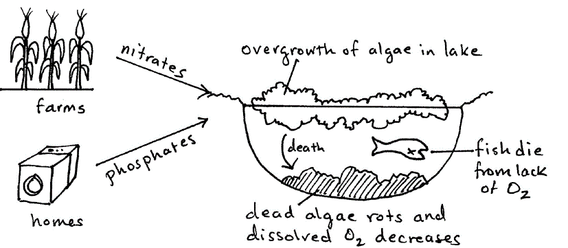

## Pollution

**Pollution due to pesticides:**

* **Insecticides (kill insects):** meant to kill insects which eat crops, but can kill other useful insects such as bees, which are pollinators, or by bioaccumulation (the increase in the dose of toxin from one level of the food chain to the next)
* **Herbicides (kill weeds):** can be harmful to animals which eat the plants

**Non-biodegradable plastics:**

* Choke birds, fish and other animals
* Fill up the animals’ stomachs so that they can’t eat food
* Collect in rivers and get in the way of fish

**Global Warming:**

* Increase in the average temperature of the Earth
* Methane from the burping of cows
* It started at the same time as humans began burning fossil fuels
* Scientists have proven that fossil fuels are one of the main factors causing this
* It increased carbon dioxide and methane concentrations in the atmosphere, enhancing the greenhouse effect that leads to climate change.

**Eutrophication:** when water plants receive too many nutrients.

* Fertilisers are put in soil by farmers.
* Fertilisers with nitrates/detergents with phosphates leach into rivers and lakes after rain.
* Water plants grow more than usual
* They block sunlight and kill plants underneath
* They die and sink to the bottom
* Bacteria/fungi decompose remains using the O2 and decreasing the O2 concentration
* Fish and other creatures die from oxygen starvation

