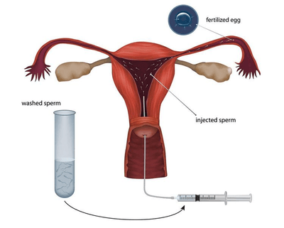

## Artificial Insemination in Captive Breeding Programmes

 

* The sperm/gamete is collected from the male.
* Males can be chosen from different breeding programmes to maximise genetic variation.
* The sperm is screened for quality checks.
* After checking, the sperm/semen is frozen, and the female is given drugs to induce ovulation.
* The sperm/semen is then placed in the vagina/uterus/oviduct, where the sperm/semen is inserted at the appropriate time for ovulation.

