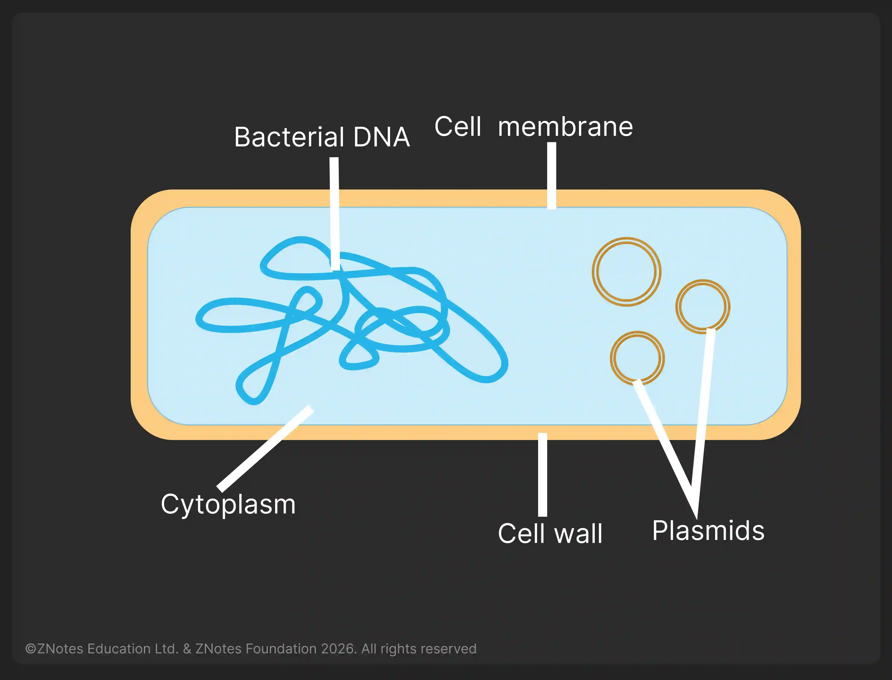

# Biotechnology and Genetic Modification

## Introduction

Bacteria are useful due to their rapid reproduction rate and ability to make complex molecules.

**Why are bacteria useful in biotechnology and genetic modification?**

1. There are a few ethical concerns over their manipulation and growth
2. The presence of plasmids
3. Producing complex molecules
4. Replicates rapidly