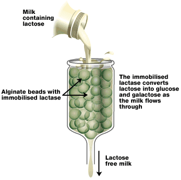

## Biotechnology

### **Biofuel**

* Use plants to make sugars, which yeast then breaks down to make ethanol.
* This process also uses anaerobic respiration.

### **Bread-Making**

* Flour, sugar, water and salt are mixed with yeast to make the dough.
* Amylase breaks down some starch to make maltose and glucose. This is used by yeast in respiration.
* The dough is kept warm and moist (28°C). Yeast ferments sugar, making carbon dioxide, which creates bubbles, so bread rises.
* Cooking (at 180°C) – kills yeast, evaporates alcohol and hardens the outer surface.

### **Use of Enzymes in Biotechnology**

**Pectinase:**

* Fruit juices are extracted using pectinase (breaks down pectin)
* Pectin helps plant walls stick together
* If pectin is broken down, it’s easier to squeeze juice from the fruit
* Extraction of juice from fruit, making juice clear, not cloudy

**Biological Washing powders:**

* Biological washing powders and liquids contain enzymes that help remove the stain
* The enzymes are coated with a special wax that melts in the wash, releasing the enzyme
* Once the stains have been broken down, they are easier for detergents to remove
* **Proteases:** break down proteins in stains, e.g., grass, blood
* **Lipases:** break down stains containing fats and oil
* **Amylases:** break down carbohydrate-based stains, such as starch
* **Cellulases:** break down cellulose fibres

**Lactase:**

* The enzyme that breaks down lactose (the sugar found in milk), people can stop making lactase naturally and, therefore, can’t digest lactose.  

**Lactose-free milk production**

* Lactase is made from yeast
* Lactase bound to the surface of alginate beads
* Milk passed down beads
* Lactose is broken down into glucose and galactose
* Immobilized enzymes are reused