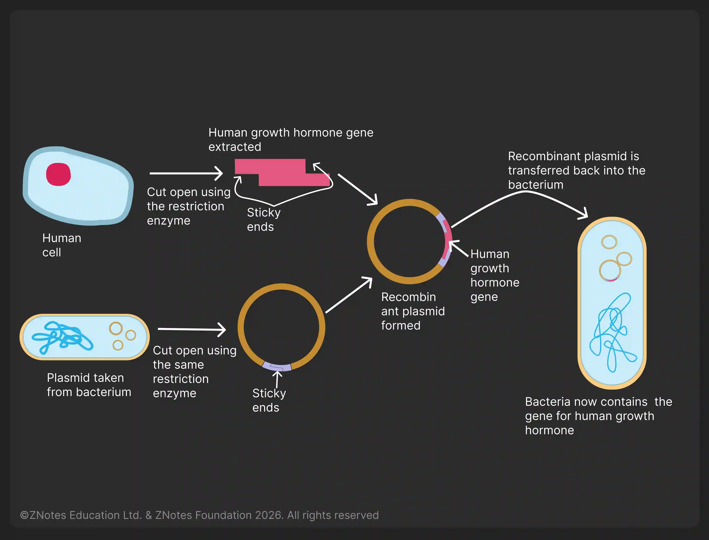

## Genetic Modification

**Genetic Modification:** changing the genetic material of an organism by removing, altering, or inserting individual genes

* **Examples of genetic modification:**
  * the insertion of human genes into bacteria to produce human insulin
  * the insertion of genes into crop plants to confer resistance to herbicides
  * the insertion of genes into crop plants to confer resistance to insect pests
  * the insertion of genes into crop plants to provide additional vitamins

### **Human Insulin in Bacteria**  

* Isolation of the DNA making up a human gene using restriction enzymes, forming sticky ends.
* Cutting of bacterial plasmid DNA with the same restriction enzymes, forming complementary sticky ends.
* Insertion of human DNA into bacterial plasmid DNA using DNA ligase to form a recombinant plasmid – insertion of the plasmid into bacteria.
* Replication of bacteria containing recombinant plasmids, which make human protein as they express the gene