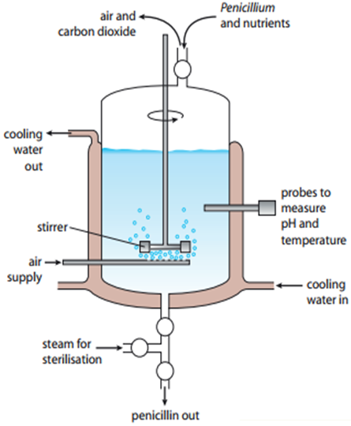

## Fermenters

* **Penicillin:** an antibiotic produced by a fungus called **Penicillium**.
* They require proper temperature, pH, oxygen, nutrient supply and waste products.
* The stainless steel fermentation vessel contains a medium containing sugars and ammonium salts.
* Penicillium is added to produce penicillin. They use sugar for
  respiration and ammonium salts to make protein and nucleic acids
* The fermentation vessel consists of ‘**PAWS’**
  * **Probes** monitor temperature and pH
  * **Air** provides oxygen for aerobic respiration in fungus
  * A **water-cooled jacket** removes heat to maintain a temperature of 24°C.
  * **Stirrer** keeps the microorganism suspended (allowing access
    to nutrients and oxygen) while maintaining an even temperature.

<!-- end list -->

* It is filtered to remove fungus and then can be crystallized to make capsules.

### **Mycoprotein**

* The fungus Fusarium is cultured (grown) on an industrial scale in fermenters.
* These fermenters are large vats that can be kept at the optimum pH and temperature to grow.
* The fungus is grown in aerobic conditions and provided with glucose syrup as a food source.
* The fungus grows and multiplies within the fermenter
* It is then harvested and purified to produce mycoprotein
* Mycoprotein is a protein-rich food suitable for vegetarians, eg. It is used in QuornTM products (a brand of meat substitute products).